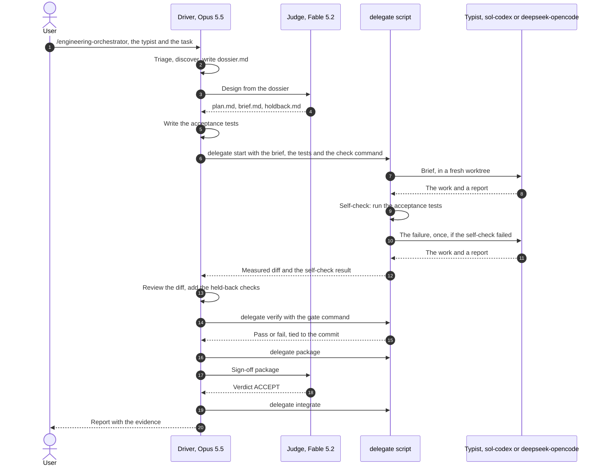

# orchestrator-workflow

A Claude Code skill that builds a substantial coding task with three models
instead of one. Claude plans the work and checks it. A cheaper model types it.
Nothing the cheaper model writes is accepted until it passes tests that Claude
wrote first.

You run it with one command, inside your project:

```
/engineering-orchestrator sol-codex add rate limiting to the public API
```

**On this page:**
[The three seats](#the-three-seats) ·
[Quick start](#quick-start) ·
[Choosing the typist](#choosing-the-typist) ·
[What happens during a task](#what-happens-during-a-task) ·
[Why the result can be trusted](#why-the-result-can-be-trusted) ·
[How the typist is controlled](#how-the-typist-is-controlled) ·
[Commands](#commands) ·
[Settings](#settings) ·
[Status](#status-and-known-limits)

## The three seats

Each model sits in the seat it is best at.

| Seat | Model | What it does |
|---|---|---|
| **Driver** | Opus 5.5, xhigh effort. This is your main Claude Code session. | Explores the code, writes the tests, reviews the result, and finishes the work itself if the typist cannot. |
| **Judge** | Fable 5.2, high effort. Runs as two subagents. | Designs risky or unclear changes, and signs off the finished change. |
| **Typist** | One of two workers. You choose. | Types the code from a written brief, in its own copy of the repository. |

The two typists are interchangeable. They get the same brief, face the same
checks and use the same commands.

| Name | Model | Runs through | What you need |
|---|---|---|---|
| `sol-codex` (the default) | GPT-6.2 Sol | the [Codex CLI](https://github.com/openai/codex) | `codex login`, with a ChatGPT plan or an API key |
| `deepseek-opencode` | DeepSeek V4.1 Flash | [OpenCode](https://opencode.ai) | an OpenCode provider that serves the model |

Two helpers keep the driver's context small. The built-in Explore subagent does
the searching, and a `test-runner` subagent (Haiku 5.5) runs the tests and
returns a short result.

A Claude-only version of the same pipeline, with an Opus typist, is in
[claude-orchestrator-workflow](https://github.com/joshuachuaaa/claude-orchestrator-workflow).

## Quick start

### 1. What you need

- Claude Code with access to Opus 5.5, Fable 5.2 and Haiku 5.5
- git and Python 3, on Linux, macOS, or Windows with Git Bash
- The CLI for the typist you will use. You do not need both.
  - `sol-codex`: the Codex CLI, signed in with `codex login`
  - `deepseek-opencode`: OpenCode, with a provider that serves DeepSeek V4.1
    Flash

### 2. Install

```bash
git clone https://github.com/joshuachuaaa/orchestrator-workflow.git
```

```bash
cd orchestrator-workflow && ./install.sh
```

The installer copies the skill and its subagents into `~/.claude`, copies the
DeepSeek worker's agent file into `~/.config/opencode/agents`, and links the
`delegate` command into `~/.local/bin`. If a file is already there and differs,
it is left alone unless you pass `--force`.

Make sure `~/.local/bin` is on your `PATH`. On Windows, run the installer from
Git Bash; `delegate` is installed there as a small launcher instead of a link.

### 3. Check your typist

Inside any git repository, run the check for the typist you will use:

```bash
delegate check --typist sol-codex
```

```bash
delegate check --typist deepseek-opencode
```

A passing check looks like this:

```
ok  typist        sol-codex (GPT-6.2 Sol)
ok  codex         codex-cli <version>
ok  model         openai/gpt-6.2-sol#xhigh
ok  sandbox       workspace-write (writes stay in the worktree; no network)
ok  sign-in       Logged in using ChatGPT
preflight passed
```

If something is missing, the check stops and says what. For example, if Codex
does not offer GPT-6.2 Sol to you, it lists the models Codex does offer. See
[Status and known limits](#status-and-known-limits) if that happens.

### 4. Run a task

Open Claude Code on Opus 5.5, inside your project's git repository, and type the
skill's name, the typist, and the task:

```
/engineering-orchestrator sol-codex add rate limiting to the public API
```

```
/engineering-orchestrator deepseek-opencode add rate limiting to the public API
```

The skill only runs when you type its name. Its first line is a triage line,
such as:

```
Triage: design=fable, typist=worker (sol-codex), pieces=1, signoff=yes
```

If the task is too small to be worth the overhead, it tells you so and does
the task directly. When it finishes, the change is staged in your checkout,
not committed, and you get a report with the evidence.

### 5. Optional: fewer permission prompts

To stop Claude Code asking before every `delegate` command, add these to
`permissions` in `~/.claude/settings.json`, with your own home directory:

```json
{
  "additionalDirectories": [
    "/home/you/.local/state/eng-orch",
    "/home/you/.local/share/eng-orch"
  ],
  "allow": [
    "Bash(delegate:*)",
    "Read(~/.local/state/eng-orch/**)",
    "Edit(~/.local/state/eng-orch/**)",
    "Read(~/.local/share/eng-orch/**)",
    "Edit(~/.local/share/eng-orch/**)"
  ]
}
```

## Choosing the typist

There are three ways to choose. The first one that applies wins.

1. **In the request.** Start the task with `sol-codex` or `deepseek-opencode`,
   as in the examples above.
2. **As your default.** Set `ENG_ORCH_TYPIST=deepseek-opencode` (or `sol-codex`)
   in your shell profile.
3. **Neither.** The typist is `sol-codex`.

The driver never changes the typist by itself. If the typist you chose is not
ready, it stops and tells you why.

How the two differ:

| | `sol-codex` | `deepseek-opencode` |
|---|---|---|
| Effort for the first attempt | xhigh | max |
| Effort for a correction | xhigh | max |
| What the brief contains | exact contracts and the files to read; the internals are left to the typist | the internal structure as well |
| Worth using from | about 100 changed lines | about 200 changed lines |
| Kept in bounds by | Codex's `workspace-write` sandbox | the permission list in its agent file |
| Billing | your ChatGPT plan's Codex allowance, or API credit | your OpenCode provider |

Which should you use? Sol costs many times what DeepSeek does per token, so it
does not make the typist seat cheaper. It is the default because the driver is
the expensive seat, and a stronger typist is expected to take work off it: fewer
corrections, fewer takeovers, shorter briefs. That is an expectation, not a
measurement. [Measure it](#measuring-whether-it-pays-off) on your own tasks.

Sol runs at xhigh for every round. Launch-week measurements put xhigh about one
index point above high, for more than twice the cost. For a cheaper first
attempt, set `variant` back to `high` in the `sol-codex` entry of the `WORKERS`
table at the top of `delegate`; corrections stay at xhigh.

## What happens during a task

In plain steps:

1. **Triage.** The driver decides whether the task is big enough, who designs
   it, who types it, and whether it needs a sign-off.
2. **Discover.** The driver reads the code it needs, with Explore doing the
   searching.
3. **Design.** For a risky or unclear change, Fable writes the plan. Otherwise
   the driver does. Either way the result is a written brief for the typist.
4. **Tests first.** The driver writes the acceptance tests before any code
   exists.
5. **Type.** The typist implements the brief in its own git worktree, a separate
   copy of the repository, with the tests already in it.
6. **Self-check.** The script runs the acceptance tests. If they fail, it tells
   the typist once and lets it fix the problem.
7. **Review and gate.** The driver reads the real diff, adds checks the typist
   never saw, and runs the full test command.
8. **Correct or take over.** If the gate fails, the typist gets one correction.
   If it fails again, the driver finishes the work itself.
9. **Sign off and integrate.** Where the change is risky, Fable judges it. Then
   the change is staged in your checkout, and you get the report.

The same thing as a diagram. Blue is the driver, purple is the judge, green is
the typist, and amber is the gate.


The models never talk to each other. Work passes between them as files, and the
`delegate` script measures what the typist actually produced.



## Why the result can be trusted

**The gate sets the quality, not the typist.** The cheaper model types, but
nothing it writes is accepted on its word. A change gets in only after it passes
checks at least as strong as the driver would apply to its own work:

1. **Acceptance tests written first.** The driver writes them before any code
   exists and puts them in the typist's worktree. If they change afterwards, the
   gate refuses.
2. **Held-back checks.** Two to five checks the typist never sees, added after
   it has finished.
3. **A measured diff.** The driver reviews the real diff and the real test exit
   code, both produced by the script. The typist's own report is treated as a
   claim.
4. **One correction, then takeover.** The typist gets one correction per stage.
   If the gate still fails, the driver finishes the work itself, so the result
   is never worse than the driver working alone.
5. **Sign-off where it matters.** Fable judges the verified change when it
   designed it, or when the change touches a risky area: auth, money, data
   migrations, concurrency, security, or a public API.

## How the typist is controlled

There is no chat to steer. The driver writes a file and runs `delegate`; the
script does the rest. For each task it starts one session with the typist and
keeps the session's id, so every later message goes into the same conversation
and the typist keeps its context.

### `sol-codex`

- **First turn.** `codex exec --json -m gpt-6.2-sol -c
  model_reasoning_effort="xhigh" -s workspace-write -C <worktree>`, with the brief
  on standard input.
- **Later turns.** `codex exec resume <session id>`, at the effort for that
  turn. Changing the effort on a resumed turn keeps the prompt cache; that was
  measured.
- **The sandbox.** The typist can write only inside its worktree and the temp
  directory, and its commands have no network. It cannot commit, so the script
  commits what it leaves. A test command that needs the network will not run
  for it.
- **The record.** After each round the script reads the session file Codex
  keeps and prints the model, effort, sandbox and directory of every turn. A
  turn on another model, outside the sandbox or outside the worktree fails the
  round.

### `deepseek-opencode`

- **Every turn.** `opencode run --agent eng-implementer`, continued with
  `--session <id>`.
- **The limits.** The agent file's permission list denies pushes, deploys,
  publishing, network fetches, secrets and anything outside the worktree.
- **The record.** After each round the script asks OpenCode which model
  answered and where the session ran, and fails the round on a mismatch.

### Following a round

As soon as the typist's session has started, usually within a minute, the
script prints a `resume` line, and prints it again in the round's summary:

```
resume     cd <worktree> && codex resume <session id>
```

For `deepseek-opencode` it is `cd <worktree> && opencode -s <session id>`. The
driver passes the line on to you; open it in a terminal to watch the typist
work. Only watch. A message typed there runs outside the script, and a turn on
another model or sandbox fails the next round's record check.

### The self-check

`delegate start --check '<command>'` gives the script one shell command that
runs the acceptance tests. When the typist says it has finished, the script runs
that command. If it fails, or an acceptance test was changed, the script sends
the output straight back into the typist's session, once, and checks again.

A typist that stopped early or broke a test hears about it cheaply, without the
driver spending a review and the one correction on it. The self-check does not
replace the gate, which still runs the held-back checks and the wider tests.

### No fallback model

If a typist's model cannot be reached, the script stops. It never substitutes
another model by itself.

## Commands

The driver runs these for you. You may want `check`, `status`, `stats` and
`cleanup` yourself.

| Command | What it does |
|---|---|
| `delegate check [--typist NAME]` | Checks that the typist's CLI, model and sign-in are ready |
| `delegate prep <task>` | Makes the task folder and the dossier template |
| `delegate start <task> --spec FILE --tests DIR --check CMD [--typist NAME] [--plan FILE] [--signoff]` | Starts the task: worktree, tests, first round |
| `delegate fix <task> --feedback FILE` | One correction round |
| `delegate fix <task> --feedback FILE --stage [--check CMD]` | The next stage of a staged plan |
| `delegate takeover <task> --reason TEXT` | The driver takes the task over |
| `delegate verify <task> -- <command>` | The gate. Records the result against the exact commit |
| `delegate package <task>` | Builds the sign-off package |
| `delegate signoff <task> --verdict ACCEPT\|CHANGES --file FILE` | Records the judge's verdict |
| `delegate integrate <task>` | Squashes the work into your checkout, staged and not committed |
| `delegate status [<task>]` | Where a task stands |
| `delegate stats` | Every task so far: rounds, first-pass rate, takeovers, tokens by seat |
| `delegate cleanup <task> [--force]` | Removes the task's worktree and branch |

`NAME` is `sol-codex` or `deepseek-opencode`. Only `check` and `start` take it;
after that the task remembers its typist.

## Settings

Environment variables, all optional:

| Variable | Default | What it sets |
|---|---|---|
| `ENG_ORCH_TYPIST` | `sol-codex` | The typist used when the request names none |
| `ENG_ORCH_SOL_MODEL` | `gpt-6.2-sol` | The Codex model in the `sol-codex` seat |
| `ENG_ORCH_SELFCHECK_RETRIES` | `1` | How many times a self-check failure goes back to the typist in one round |
| `ENG_ORCH_SELFCHECK_TIMEOUT_MIN` | `15` | How long one run of the check command may take |
| `ENG_ORCH_TIMEOUT_MIN` | `45` | How long one typist round may take |
| `ENG_ORCH_MAX_ROUNDS` | `6` | The most rounds one task may have |

Marker files, placed in a repository's root, switch a seat off for that
repository:

- `.no-delegate`: no code is sent to either typist's provider. The driver types.
- `.no-fable`: no Fable subagents. The driver designs, and sign-off is skipped.

Where things are kept:

- Task records: `~/.local/state/eng-orch`
- Worktrees: `~/.local/share/eng-orch`

Changing a model:

- **`sol-codex`.** Set `ENG_ORCH_SOL_MODEL`, or edit the `sol-codex` entry of
  the `WORKERS` table at the top of `delegate`.
- **`deepseek-opencode`.** The model is named in two places: the `model:` line
  of `opencode/agents/eng-implementer.md`, and the `deepseek-opencode` entry of
  the same table, which uses the OpenCode provider id `lithosai`. Run
  `opencode models` to see the ids on your machine, and change both places if
  yours differ.

## Measuring whether it pays off

```bash
delegate stats
```

It reports, across every task: how many passed the gate the first time, how
many the driver took over, how often sign-off asked for changes, and the tokens
each seat read and wrote.

Its `by typist` section compares the two typists on the same gate: first-pass
rate, takeovers, average rounds, how often the self-check failed and the typist
recovered, and what the typist used. For `deepseek-opencode` that is the cost
OpenCode reports. For `sol-codex` it is tokens, because Codex reports no cost.

A fresh Claude Code session per task keeps the token counts clean.

## What is in this repository

| Path | What it is |
|---|---|
| `skills/engineering-orchestrator/SKILL.md` | The workflow the driver follows, step by step |
| `skills/engineering-orchestrator/scripts/delegate` | The script that runs the typist, measures the diff, runs the gate and keeps the records. Python, standard library only |
| `skills/engineering-orchestrator/templates/dossier.md` | The dossier the driver fills in for the architect |
| `agents/fable-architect.md` | Fable subagent: design, and one consult |
| `agents/fable-signoff.md` | Fable subagent: final sign-off |
| `agents/test-runner.md` | Haiku subagent: runs the gate and returns a short result |
| `opencode/agents/eng-implementer.md` | The OpenCode agent for `deepseek-opencode`, with its permission list |
| `install.sh` | The installer |

## Status and known limits

This is new. There are no measurements from real tasks yet, so no claim is made
here about cost or quality against a single model.

What has been tested:

- The script has run end to end against scratch repositories with stand-ins for
  both CLIs.
- The `sol-codex` path has run for real on GPT-6.2 Sol: a small two-round task
  (a first attempt at high, a correction at xhigh, the self-check and the gate)
  with codex-cli 0.170.0 and a ChatGPT-plan sign-in, on Windows from Git Bash.

What has not:

- **Real-size tasks.** The real runs were a few lines of code in a scratch
  repository.
- **Linux and macOS, for real.** Codex's sandbox is a different implementation
  there.
- **`deepseek-opencode`, for real.** It has only run against the stand-in.

If `delegate check` says Codex does not offer GPT-6.2 Sol:

1. Update the Codex CLI. codex-cli 0.160.1 did not offer the model, and the
   server refused it ("not supported when using Codex with a ChatGPT account");
   0.170.0 offers it.

   ```bash
   codex update
   ```

2. Run `delegate check` again. Whether the model appears also depends on your
   plan and on the rollout.
3. If it is still missing and you want to carry on, choose another model
   yourself: `ENG_ORCH_SOL_MODEL=gpt-6.1-sol` puts GPT-6.1 Sol in the seat.

## License

MIT. See [LICENSE](LICENSE).
