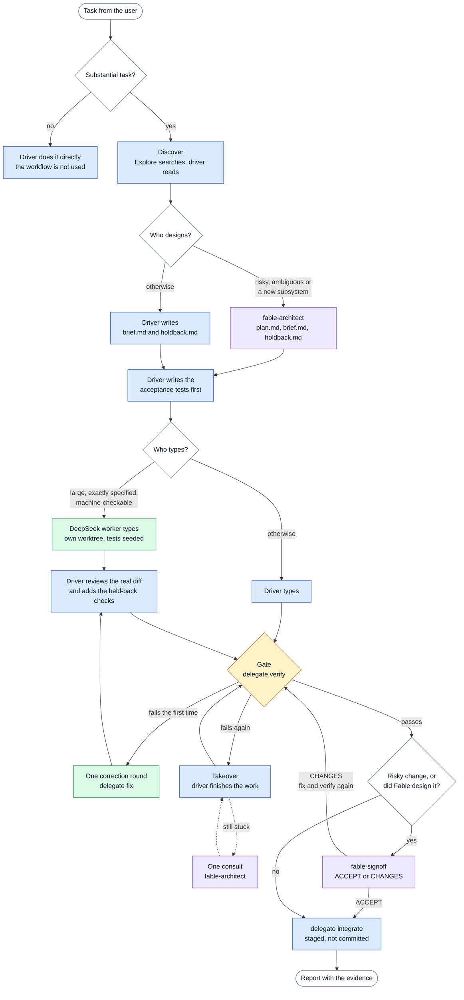
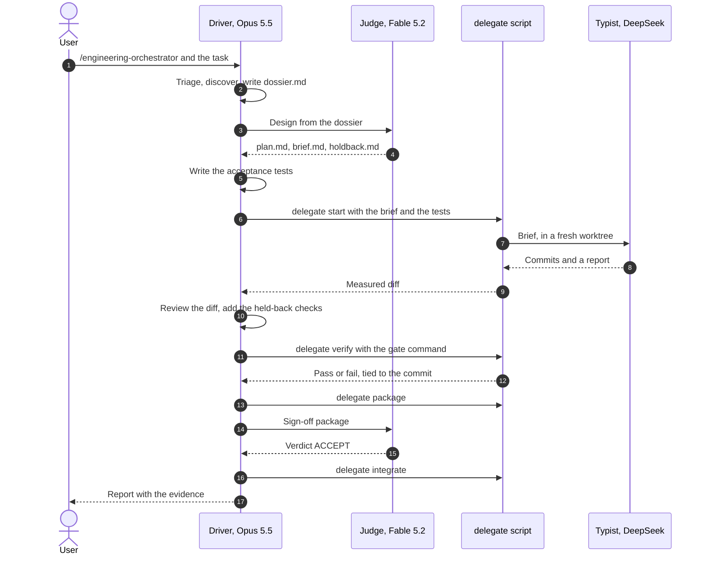

# Claude + DeepSeek orchestrator workflow

A Claude Code skill that builds a substantial coding task with three models, each
in the seat it is best at:

| Seat | Who | Model | Does |
|---|---|---|---|
| Driver | the main Claude Code session | Opus 5.5, xhigh effort | explores, writes the acceptance tests, reviews, verifies, takes over when needed, reports |
| Judge | `fable-architect` and `fable-signoff` subagents | Fable 5.2, high effort | designs risky or unclear changes, signs off the finished change, answers one consult |
| Typist | `eng-implementer` agent in [OpenCode](https://opencode.ai) | DeepSeek V4.1 Flash | types the code from a written brief, in its own git worktree |

Two helpers keep the driver's context small: the built-in Explore subagent does
the searching, and a `test-runner` subagent (Haiku 5.5) runs the gate and returns
a short result.

A Claude-only version of the same pipeline, with an Opus typist instead of
DeepSeek, is in
[claude-orchestrator-workflow](https://github.com/joshuachuaaa/claude-orchestrator-workflow).

## The idea

**The gate sets the quality, not the typist.** The cheap model types, but nothing
it writes is accepted on its word. A change gets in only after it passes checks at
least as strong as the driver would apply to its own work:

1. **Acceptance tests written first.** The driver writes them before any code
   exists and commits them into the typist's worktree. If they change afterwards,
   the gate refuses.
2. **Held-back checks.** Two to five checks the typist never sees, added after
   it has finished.
3. **A measured diff.** The driver reviews the real diff and the real test exit
   code, produced by the `delegate` script, not the typist's report.
4. **One correction, then takeover.** The typist gets one correction round per
   stage. If the gate still fails, the driver finishes the work itself, so the
   result is never worse than the driver working alone.
5. **Sign-off where it matters.** Fable judges the verified change when it
   designed it or when the change touches a risky domain (auth, money, data
   migrations, concurrency, security, public APIs).

## The pipeline



Blue is the driver (Opus), purple is the judge (Fable), green is the typist
(DeepSeek), and amber is the machine gate.

## One task, seat by seat

The models never talk to each other. Work passes between them as files in the
task directory, and `delegate` measures what the typist actually produced.



## What is in here

| Path | What it is |
|---|---|
| `skills/engineering-orchestrator/SKILL.md` | the workflow the driver follows, step by step |
| `skills/engineering-orchestrator/scripts/delegate` | the script that runs the worker, measures the diff, runs the gate and keeps the records (Python, standard library only) |
| `skills/engineering-orchestrator/templates/dossier.md` | the dossier the driver fills in for the architect |
| `agents/fable-architect.md` | Fable subagent: design, and one consult |
| `agents/fable-signoff.md` | Fable subagent: final sign-off |
| `agents/test-runner.md` | Haiku subagent: runs the gate, returns a short result |
| `opencode/agents/eng-implementer.md` | the OpenCode worker agent, with hard denies for pushes, deploys, secrets and anything outside its worktree |

## Requirements

- Claude Code with access to Opus 5.5, Fable 5.2 and Haiku 5.5
- OpenCode with a provider that serves DeepSeek V4.1 Flash
- git and Python 3

The worker's model is named in two places: the `model:` line in
`opencode/agents/eng-implementer.md`, and the `PROVIDER`, `MODEL_ID` and `VARIANT`
constants at the top of `delegate`. Both use the OpenCode provider id `lithosai`.
If your provider has a different id, change both. There is no fallback model on
purpose: if a round was served by anything else, `delegate` fails loudly.

## Install

```bash
git clone https://github.com/joshuachuaaa/claude-deepseek-orchestrator-workflow.git
```

```bash
cd claude-deepseek-orchestrator-workflow && ./install.sh
```

The installer copies the skill and subagents into `~/.claude`, the worker agent
into `~/.config/opencode/agents`, and links `delegate` into `~/.local/bin`. It
leaves any existing file that differs alone unless you pass `--force`.

Then, inside a git repository:

```bash
delegate check
```

To avoid permission prompts for the script and its task folders, add these to
`permissions` in `~/.claude/settings.json` (with your own home directory):

```json
{
  "additionalDirectories": [
    "/home/you/.local/state/eng-orch",
    "/home/you/.local/share/eng-orch"
  ],
  "allow": [
    "Bash(delegate:*)",
    "Read(~/.local/state/eng-orch/**)",
    "Edit(~/.local/state/eng-orch/**)",
    "Read(~/.local/share/eng-orch/**)",
    "Edit(~/.local/share/eng-orch/**)"
  ]
}
```

## Use

In a Claude Code session running Opus 5.5, inside the project's git repository:

```
/engineering-orchestrator add rate limiting to the public API
```

The skill only runs when you type its name. It starts with a triage line such as
`Triage: design=fable, typist=worker, pieces=1, signoff=yes`, and it will tell
you to do the task directly if it is too small to be worth the overhead.

Two marker files in a repository's root switch seats off:

- `.no-delegate`: no code is sent to the DeepSeek worker; the driver types.
- `.no-fable`: no Fable subagents; the driver designs and sign-off is skipped.

## Commands

```
delegate check                            preflight: opencode, model, agent, credentials
delegate prep <task>                      task folder and dossier template
delegate start <task> --spec FILE --tests DIR [--plan FILE] [--signoff]
delegate fix <task> --feedback FILE       one correction round
delegate takeover <task> --reason TEXT    the driver takes the task over
delegate verify <task> -- <command>       the gate; evidence tied to a commit
delegate package <task>                   sign-off package
delegate signoff <task> --verdict ACCEPT|CHANGES --file FILE
delegate integrate <task>                 squash into the main checkout, staged
delegate status [<task>]
delegate stats                            every task: rounds, first-pass rate, takeovers, tokens by seat
delegate cleanup <task> [--force]
```

Task records live in `~/.local/state/eng-orch` and worktrees in
`~/.local/share/eng-orch`.

## Measuring it

`delegate stats` reports, across every task: how many passed the gate the first
time, how many the driver took over, how often sign-off returned CHANGES, and
the tokens each seat read and wrote. Those numbers show whether the typist is
paying for itself. A fresh Claude Code session per task keeps the token counts
clean.

## Status

This is new. The script has been exercised end to end against scratch
repositories with a stand-in worker, but there are no measurements from real
tasks yet, so no claim is made here about cost or quality against a single
model.

## License

MIT. See [LICENSE](LICENSE).
