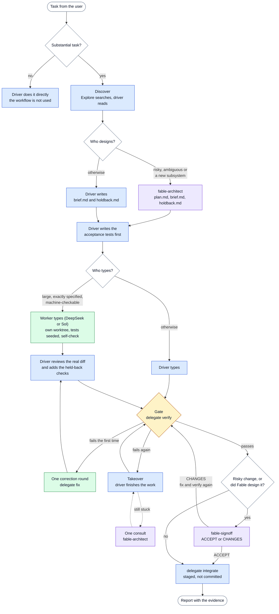
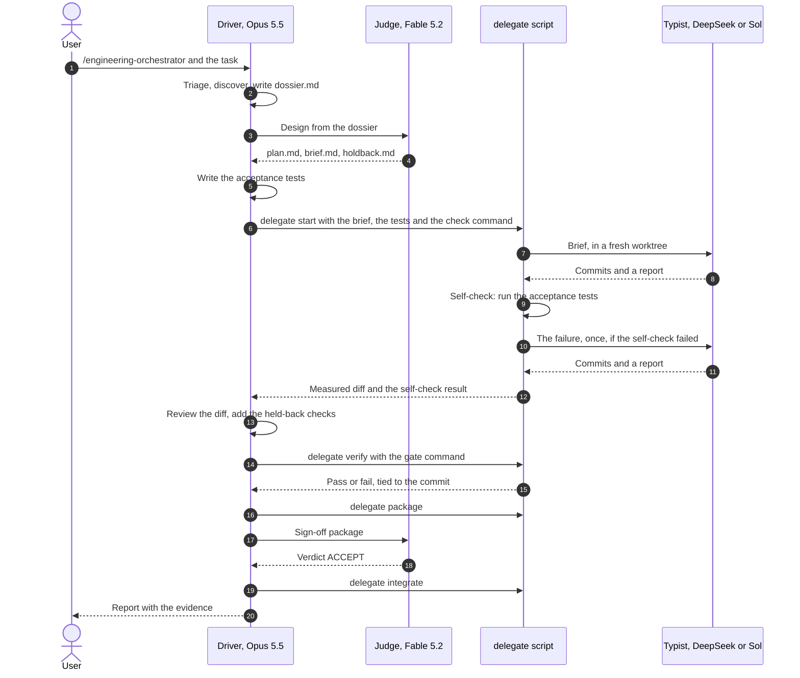

# Claude + DeepSeek orchestrator workflow

A Claude Code skill that builds a substantial coding task with three models, each
in the seat it is best at:

| Seat | Who | Model | Does |
|---|---|---|---|
| Driver | the main Claude Code session | Opus 5.5, xhigh effort | explores, writes the acceptance tests, reviews, verifies, takes over when needed, reports |
| Judge | `fable-architect` and `fable-signoff` subagents | Fable 5.2, high effort | designs risky or unclear changes, signs off the finished change, answers one consult |
| Typist | the Codex CLI (`codex exec`), or the `eng-implementer` agent in [OpenCode](https://opencode.ai) | GPT-6.2 Sol by default, or DeepSeek V4.1 Flash | types the code from a written brief, in its own git worktree |

Two helpers keep the driver's context small: the built-in Explore subagent does
the searching, and a `test-runner` subagent (Haiku 5.5) runs the gate and returns
a short result.

A Claude-only version of the same pipeline, with an Opus typist instead of a
Codex or OpenCode worker, is in
[claude-orchestrator-workflow](https://github.com/joshuachuaaa/claude-orchestrator-workflow).

## The idea

**The gate sets the quality, not the typist.** The cheap model types, but nothing
it writes is accepted on its word. A change gets in only after it passes checks at
least as strong as the driver would apply to its own work:

1. **Acceptance tests written first.** The driver writes them before any code
   exists and commits them into the typist's worktree. If they change afterwards,
   the gate refuses.
2. **Held-back checks.** Two to five checks the typist never sees, added after
   it has finished.
3. **A measured diff.** The driver reviews the real diff and the real test exit
   code, produced by the `delegate` script, not the typist's report. Before the
   driver sees a round, the script has already run the acceptance tests itself
   and sent a failure back to the typist once (the self-check, below).
4. **One correction, then takeover.** The typist gets one correction round per
   stage. If the gate still fails, the driver finishes the work itself, so the
   result is never worse than the driver working alone.
5. **Sign-off where it matters.** Fable judges the verified change when it
   designed it or when the change touches a risky domain (auth, money, data
   migrations, concurrency, security, public APIs).

## The pipeline



Blue is the driver (Opus), purple is the judge (Fable), green is the typist
(DeepSeek or Sol), and amber is the machine gate.

## One task, seat by seat

The models never talk to each other. Work passes between them as files in the
task directory, and `delegate` measures what the typist actually produced.



## What is in here

| Path | What it is |
|---|---|
| `skills/engineering-orchestrator/SKILL.md` | the workflow the driver follows, step by step |
| `skills/engineering-orchestrator/scripts/delegate` | the script that runs the worker, measures the diff, runs the gate and keeps the records (Python, standard library only) |
| `skills/engineering-orchestrator/templates/dossier.md` | the dossier the driver fills in for the architect |
| `agents/fable-architect.md` | Fable subagent: design, and one consult |
| `agents/fable-signoff.md` | Fable subagent: final sign-off |
| `agents/test-runner.md` | Haiku subagent: runs the gate, returns a short result |
| `opencode/agents/eng-implementer.md` | the OpenCode worker agent for DeepSeek, with hard denies for pushes, deploys, secrets and anything outside its worktree |

## The two workers

| | `sol` (default) | `deepseek` |
|---|---|---|
| Runs through | the Codex CLI (`codex exec`) | OpenCode (`opencode run`) |
| Model | `gpt-6.2-sol` | `lithosai/deepseek-ai/DeepSeek-V4.1-Flash` |
| Limits | Codex's `workspace-write` sandbox | the agent file's permission list |
| Effort, implementation round | high | max |
| Effort, correction round (`delegate fix`) | xhigh | max |
| Brief | exact contracts and files to read; internals left to the worker | spells out the internal structure |
| Worth dispatching from | about 100 lines | about 200 lines |

Sol is the default. To use DeepSeek for one task, name it in the request (the
driver then passes `--typist deepseek`); to make DeepSeek the default, set
`ENG_ORCH_TYPIST=deepseek` in your shell profile. `delegate check` prints which
one is in force.

Sol costs many times what DeepSeek does per token, so it does not make the
typist seat cheaper. It is the default because the driver is the expensive
seat, and a stronger typist is expected to take work off it: fewer correction
rounds, fewer takeovers, shorter briefs. That is an expectation, not a
measurement. `delegate stats` has a `by typist` section so you can check it on
your own tasks; run a few on DeepSeek to compare.

Sol's effort ladder is deliberate. High is used for implementation because
launch-week measurements put xhigh about one index point above high for more
than twice the cost. The correction round, where the worker has already failed
once, is the place for xhigh. A later stage of a staged plan
(`delegate fix --stage`) is new work and runs at high.

Sol runs under whatever `codex login` is signed in with. Signed in with a
ChatGPT plan, its rounds draw on that plan's Codex limits and not on API
credit. `delegate check` prints which it is.

### How Sol is driven

There is no chat to steer. For each task `delegate` starts one Codex session
and keeps its id:

- The first turn is `codex exec --json -m gpt-6.2-sol -c
  model_reasoning_effort="high" -s workspace-write -C <worktree>`, with the
  brief on standard input.
- Every later turn (a self-check failure, a correction, a later stage) is
  `codex exec resume <session id>` with the effort for that turn, so the worker
  keeps its context. Changing the effort on a resumed turn keeps the prompt
  cache; that was measured, on GPT-6.1 Sol.
- The sandbox confines the worker's writes to its worktree and the temp
  directory and gives its commands no network. It cannot commit, because the
  repository's git directory is outside the worktree; the script commits what
  it leaves. A test command that needs the network will not run for it.
- After the round the script reads the session file Codex keeps and prints the
  model, effort, sandbox and directory of every turn. A turn on another model,
  outside the sandbox or outside the worktree fails the round.

### The self-check

`delegate start --check '<command>'` gives the script one shell command that
runs the acceptance tests. When the worker says it has finished, the script
runs the command on the committed worktree. If it fails, or a seeded acceptance
test was changed, the script sends the output straight back into the worker's
own session, once, and checks again. A worker that stopped early or broke a
test hears about it at cached-input prices, without the driver spending a
review and its one correction round on it.

The self-check is not a worker round and does not replace `delegate verify`:
the gate still runs the held-back checks and the wider suite. Files the check
command leaves behind are removed, so they never reach the diff.
`ENG_ORCH_SELFCHECK_RETRIES` (default 1) and `ENG_ORCH_SELFCHECK_TIMEOUT_MIN`
(default 15) tune it.

## Requirements

- Claude Code with access to Opus 5.5, Fable 5.2 and Haiku 5.5
- The [Codex CLI](https://github.com/openai/codex), signed in (`codex login`),
  for GPT-6.2 Sol, the default typist
- OpenCode with a provider that serves DeepSeek V4.1 Flash, only if you use the
  DeepSeek worker
- git and Python 3

Sol's model is the `sol` entry of the `WORKERS` table at the top of `delegate`.
`ENG_ORCH_SOL_MODEL` puts another Codex model in that seat without editing the
file (`ENG_ORCH_SOL_MODEL=gpt-6.1-sol`, say). `delegate check` reads Codex's own
model catalog and refuses, listing what is offered, if the model or one of its
two efforts is missing; an older Codex CLI may need `codex update` first.

DeepSeek's model is named in two places: the `model:` line of its agent file
under `opencode/agents/`, and its entry in the same table, which uses the
OpenCode provider id `lithosai`. Run `opencode models` to see the ids on your
machine, and change both places if yours differ.

There is no fallback model on purpose: if a round ran on anything else,
`delegate` fails loudly.

## Install

```bash
git clone https://github.com/joshuachuaaa/claude-deepseek-orchestrator-workflow.git
```

```bash
cd claude-deepseek-orchestrator-workflow && ./install.sh
```

The installer copies the skill and subagents into `~/.claude`, the DeepSeek
worker's agent into `~/.config/opencode/agents`, and links `delegate` into
`~/.local/bin`. It leaves any existing file that differs alone unless you pass
`--force`.

Then, inside a git repository, check the worker you mean to use:

```bash
delegate check --typist sol
```

```bash
delegate check --typist deepseek
```

To avoid permission prompts for the script and its task folders, add these to
`permissions` in `~/.claude/settings.json` (with your own home directory):

```json
{
  "additionalDirectories": [
    "/home/you/.local/state/eng-orch",
    "/home/you/.local/share/eng-orch"
  ],
  "allow": [
    "Bash(delegate:*)",
    "Read(~/.local/state/eng-orch/**)",
    "Edit(~/.local/state/eng-orch/**)",
    "Read(~/.local/share/eng-orch/**)",
    "Edit(~/.local/share/eng-orch/**)"
  ]
}
```

## Use

In a Claude Code session running Opus 5.5, inside the project's git repository:

```
/engineering-orchestrator add rate limiting to the public API
```

The skill only runs when you type its name. It starts with a triage line such as
`Triage: design=fable, typist=worker (sol), pieces=1, signoff=yes`, and it will
tell you to do the task directly if it is too small to be worth the overhead.

Two marker files in a repository's root switch seats off:

- `.no-delegate`: no code is sent to either worker's provider; the driver types.
- `.no-fable`: no Fable subagents; the driver designs and sign-off is skipped.

## Commands

```
delegate check [--typist sol|deepseek]    preflight: which worker, its CLI, model, sandbox or agent, sign-in
delegate prep <task>                      task folder and dossier template
delegate start <task> --spec FILE --tests DIR --check CMD [--typist sol|deepseek] [--plan FILE] [--signoff]
delegate fix <task> --feedback FILE       one correction round
delegate fix <task> --feedback FILE --stage [--check CMD]   the next stage of a staged plan
delegate takeover <task> --reason TEXT    the driver takes the task over
delegate verify <task> -- <command>       the gate; evidence tied to a commit
delegate package <task>                   sign-off package
delegate signoff <task> --verdict ACCEPT|CHANGES --file FILE
delegate integrate <task>                 squash into the main checkout, staged
delegate status [<task>]
delegate stats                            every task: rounds, first-pass rate, takeovers, tokens by seat
delegate cleanup <task> [--force]
```

Task records live in `~/.local/state/eng-orch` and worktrees in
`~/.local/share/eng-orch`.

## Measuring it

`delegate stats` reports, across every task: how many passed the gate the first
time, how many the driver took over, how often sign-off returned CHANGES, and
the tokens each seat read and wrote. Its `by typist` section gives, for each
worker, the first-pass rate, the takeovers, the average rounds, the cost as
OpenCode reports it (for Sol, the tokens Codex reports), and how often the self-check failed and the worker
recovered. Those numbers show whether the typist is paying for itself. A fresh
Claude Code session per task keeps the token counts clean.

## Status

This is new. The script has been exercised end to end against scratch
repositories with stand-in workers, but there are no measurements from real
tasks yet, so no claim is made here about cost or quality against a single
model.

The Codex path has also run for real, once: a two-round task (implementation at
high, a correction at xhigh, the self-check and the gate) with codex-cli 0.160.1
and GPT-6.1 Sol, on Windows. It has not run with GPT-6.2 Sol: that CLI version's
catalog did not list it, so `gpt-6.2-sol` is the expected id, not a confirmed
one. It has not run for real on Linux or macOS either, where Codex's sandbox is
a different implementation. Run `delegate check` before the first task: it says
whether the model is there and names what Codex offers. Until it is,
`ENG_ORCH_SOL_MODEL=gpt-6.1-sol` keeps the Sol seat working.

## License

MIT. See [LICENSE](LICENSE).
